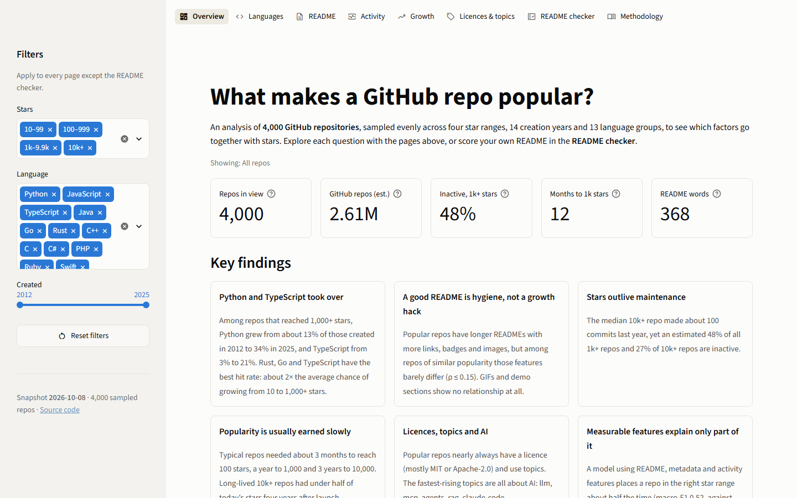
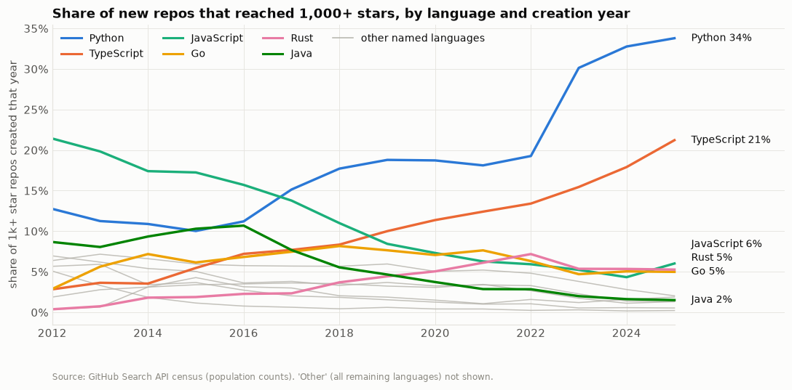
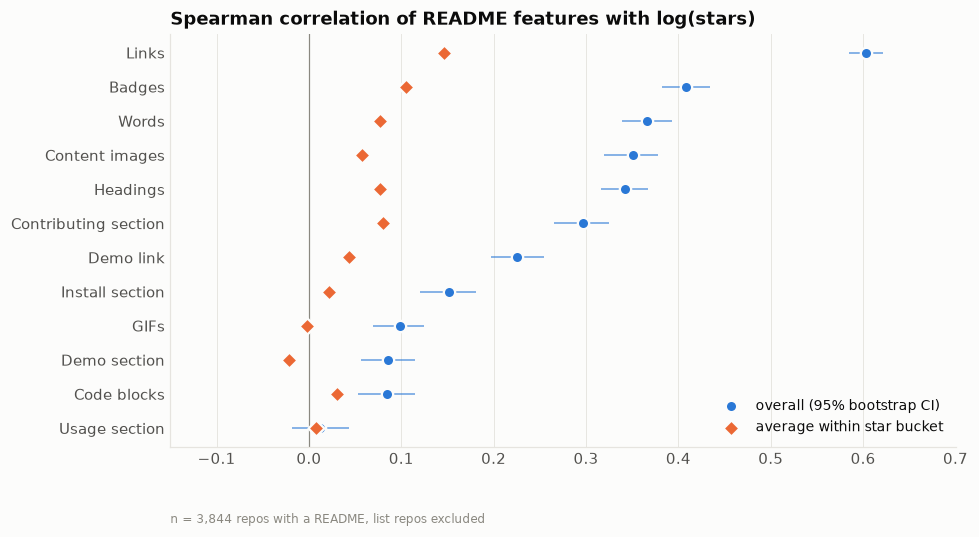
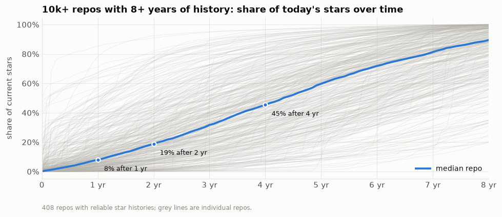
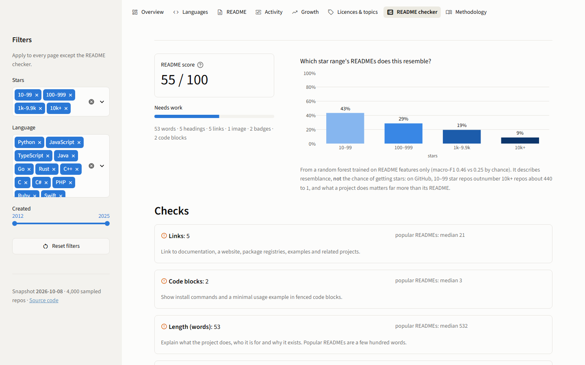
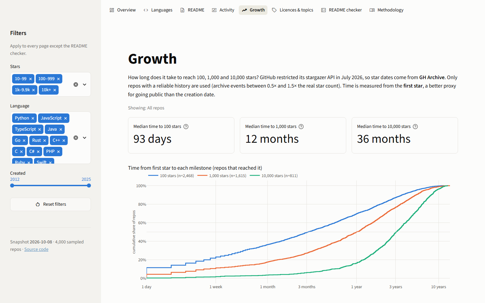
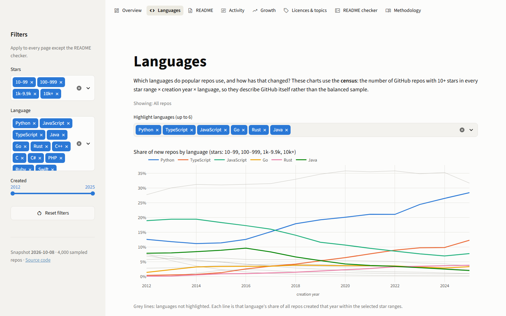
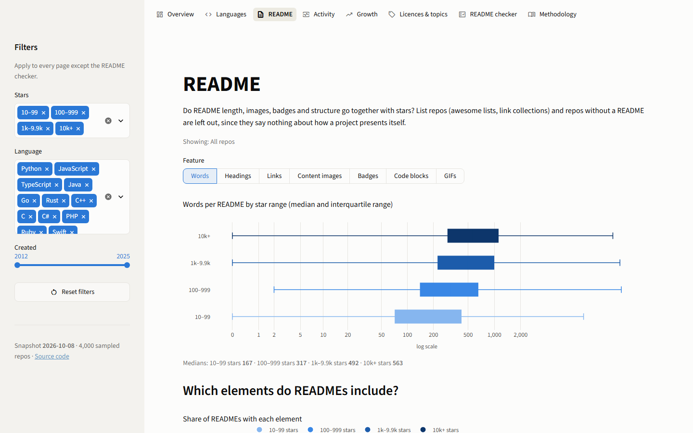

# What Makes a GitHub Repo Popular?

An end-to-end data science project. **4,000 GitHub repositories** were sampled through the GitHub REST
API and analysed to see which factors go together with stars: language, README quality, commit
activity, licence and topics. Star histories come from GH Archive. The results are presented in
notebooks and in an interactive Streamlit dashboard that includes a **README checker**.



**Contents:** [Key findings](#key-findings) · [Dashboard](#dashboard) · [How it works](#how-it-works) ·
[Data](#data) · [Analysis](#analysis) · [Limitations](#limitations) · [Run it yourself](#run-it-yourself) ·
[Deploy](#deploy-to-streamlit-community-cloud)

## Key findings

Snapshot of 8 October 2026. Population figures are weighted by the census of 2.6 million GitHub repos
with 10+ stars created in 2012–2025.

1. **Python and TypeScript took over.** Among repos that went on to collect 1,000+ stars, Python's
   share grew from about 13% of those created in 2012 to 34% of those created in 2025, and
   TypeScript's from 3% to 21%. JavaScript fell from 21% to 6%, and Java, PHP and Ruby to 2% or less.
   Rust, Go and TypeScript have the best **hit rate**: a repo with 10+ stars in one of these
   languages is about twice as likely as average to grow past 1,000.

   

2. **A good README is hygiene, not a growth hack.** Popular repos have longer READMEs with more
   links, badges, images and contributing sections. Overall, links correlate with stars at
   ρ ≈ 0.6. Among repos of *similar* popularity, though, these features barely differ (ρ ≤ 0.15),
   and GIFs and demo sections show no relationship at all. Rich READMEs look more like something
   projects grow into than a cause of stars.

   

3. **Stars outlive maintenance.** The median 10k+ repo made about 100 commits in the past year, yet
   an estimated **48% of all repos with 1,000+ stars** (and 27% of those with 10,000+) are
   inactive: archived, unpushed for a year, or without commits in 52 weeks.

4. **Popularity is usually earned slowly.** Repos that reached each milestone typically needed about
   3 months to reach 100 stars, a year to 1,000 and 3 years to 10,000, counted from the first star.
   Viral launches exist (the fastest tenth reached 1,000 in 5 days), but long-lived 10k+ repos had
   collected under half of today's stars four years after launch. Compared over equal observation
   windows, recent launches do reach 1,000 stars faster: 60% within a year for 2019–2021 launches,
   against 22% for 2012 launches.

   

5. **Licences, topics and AI.** Popular repos nearly always declare a licence (8% of 10k+ repos have
   none, against 36% of 10–99 star repos), mostly MIT or Apache-2.0, and use topics. The fastest-rising
   topics are all about AI: `llm`, `mcp`, `ai-agents`, `agentic-ai`, `rag`, `claude-code`.

6. **Measurable features explain only part of it.** A random forest using README, metadata and
   activity features places a repo in the right star range about half the time (macro-F1 0.52,
   against 0.25 for guessing). Most of what makes a project popular is not visible in these numbers:
   usefulness, timing, audience and luck.

## Dashboard

An interactive Streamlit app with eight pages and shared filters for star range, language and
creation year. It reads only the processed data committed in this repo and never calls the GitHub
API.

| README checker | Growth |
|---|---|
|  |  |
| **Languages** | **README** |
|  |  |

| Page | What it shows |
|---|---|
| Overview | key numbers (they follow the filters) and the headline findings |
| Languages | census-based language trends with selectable highlights, and hit rates |
| README | README features by star range, section prevalence, overall vs within-range correlations |
| Activity | inactive share (sample and population-weighted), commits, and inactivity by creation year |
| Growth | time to 100/1k/10k stars, a fair launch-cohort comparison, and a star-history explorer for 2,468 repos |
| Licences & topics | licence mix, most common topics, rising topics |
| **README checker** | paste or upload a README: a 0–100 score against 1k+ star repos, per-check advice, and which star range's READMEs it resembles |
| Methodology | data sources, sampling, features and limitations |

## How it works

```
GitHub REST API ──► collector ──► SQLite ──► feature build ──► data/processed/*.parquet ──┬─► notebooks
GH Archive (ClickHouse) ──┘   (resumable,      (README parser,                           └─► Streamlit app
                              rate-limited)     growth, metadata)
```

| Step | Command | Code |
|---|---|---|
| 1. Collect | `python -m wgs.collector run` | [`wgs/collector/`](wgs/collector) |
| 2. Build features | `python -m wgs.features.build` | [`wgs/features/`](wgs/features) |
| 3. Analyse | notebooks | [`notebooks/`](notebooks) |
| 4. Explore | `streamlit run app/streamlit_app.py` | [`app/`](app) |

Engineering highlights:

- **Rate-limit aware client.** It tracks the core and search quotas separately, sleeps until the
  reset time, honours `Retry-After` and backs off exponentially on errors. Waiting for a quota never
  counts as a failed attempt.
- **Resumable collection.** Every result is committed to SQLite immediately and search pages are
  cached, so a stopped run continues where it left off without repeating requests. This was tested
  by killing the process mid-run. The real run was suspended twice by the laptop sleeping and
  resumed without refetching anything.
- **Built around API limits.** It works around the Search API's 1,000-result cap and "best match"
  ordering, retries the statistics endpoint's `202 Accepted` responses, and switched to GH Archive
  when GitHub restricted stargazer data in July 2026.
- **Tests.** 83 pytest tests cover the client (mocked HTTP), storage, sampling, README parsing,
  features, statistics, scoring, and every dashboard page under several filter states.

## Data

### Sampling

The sample is **stratified**, so unpopular repos are represented as well as popular ones:

| Dimension | Values |
|---|---|
| Star range | 10–99, 100–999, 1k–9.9k, 10k+ (1,000 repos each) |
| Creation year | 2012–2025 |
| Language group | Python, JavaScript, TypeScript, Java, Go, Rust, C++, C, C#, PHP, Ruby, Swift, Other |

The Search API returns at most 1,000 results per query and orders them by "best match", so each of
the 728 strata is sampled from randomly chosen date windows (year → month → day) and result pages.
The `total_count` of every stratum is stored as a **census**. It gives the size of the population
behind each sampled repo, which is used for language trends and population-weighted estimates.

For each repo the collector stores the repository metadata, the README text and the commits per
week over the last 52 weeks.

### Star history from GH Archive

GitHub [restricted the stargazer listing endpoints](https://github.blog/changelog/2026-06-30-upcoming-access-restrictions-to-public-api-endpoints-and-ui-views/)
to repository admins and collaborators in July 2026, so star dates can no longer be read from the
API. Instead, daily star counts come from [GH Archive](https://www.gharchive.org/), a public record
of GitHub events since 2011 in which each star is a `WatchEvent`. The archive is queried through
ClickHouse's free [public playground](https://play.clickhouse.com/), with no download and no GitHub
quota needed.

The archive is not a perfect mirror of GitHub:

- It misses some events.
- It does not record unstars.
- It loses history from before a rename. The collector queries both the old and the current name to
  recover some of it.

Each repo therefore gets a **coverage ratio** (archive events ÷ current stars). Only histories with
coverage between 0.5 and 1.5 are used for growth analysis (2,468 of 2,984), and milestone dates are
corrected for coverage.

### Collection run

| | |
|---|---|
| Repositories | **4,000**: 1,000 per star range |
| Strata | 728. 46 had fewer repos than their quota (mostly 10k+ repos created recently), and their unused quota moved to other strata in the same range |
| Repo details / README / commit activity | 4,000 / 3,947 (53 have no README) / 3,991 (5 too large for GitHub's statistics) |
| Star history | 3,000 repos with 100+ stars, 3.1M daily rows, median coverage 0.93 |
| API usage | about 1,900 search and 14,900 core requests, about 5 hours of active run time |

### Processed data (`data/processed/`)

| File | Contents |
|---|---|
| `repos.parquet` | one row per repo: metadata, activity, README and growth features |
| `repo_topics.parquet` | one row per (repo, topic) pair |
| `star_monthly.parquet` | cumulative stars per month for repos with a reliable history |
| `population.parquet` | census: GitHub repos per star range × year × language group |
| `readme_benchmarks.json` | README feature percentiles per star range, used by the checker |
| `build_report.json` | validation summary |

README text is never published. It belongs to each repo's authors, so only features derived from
it are committed.

**README features** (Markdown parsed with `markdown-it-py`):

- **Length:** word count, excluding code, URLs and markup.
- **Structure:** headings, deepest heading level, code blocks, tables and links.
- **Images**, split into three kinds:
  - *content images*: screenshots, diagrams and GIFs;
  - *badges*;
  - *decorations*: avatars, sponsor logos and icons, so a wall of sponsor avatars does not count as
    screenshots.
- **Sections:** install, usage, demo, contributing and licence sections, and links to a live demo or
  video.

**Metadata features:**

- **Age and activity:** repo age, days since the last push, stars per day, and commits and active
  weeks in the last 52 weeks.
- **Topics and licence:** number of topics and a grouped licence.
- **Repo type:** a flag for awesome lists and other link collections.
- **Inactive:** a repo is inactive when it is archived, has had no push in 365 days, or had no
  commits in 52 weeks.

## Analysis

| Notebook | Contents |
|---|---|
| [`01_analysis.ipynb`](notebooks/01_analysis.ipynb) | data overview, cleaning decisions, one section per research question, correlation overview, conclusions and limitations |
| [`02_model.ipynb`](notebooks/02_model.ipynb) | random forest predicting the star range vs baselines: cross-validation, held-out test, confusion matrix, permutation importance; trains the README-only model used by the checker |

Both notebooks are committed with their outputs, so they can be read on GitHub. The analysis takes
care to:

- **Not treat the balanced sample as GitHub.** Population numbers use census weights or the census
  itself, and other comparisons are made within a star range.
- **Use rank-based statistics with bootstrap confidence intervals**, because stars, README length and
  badge counts have extremely long tails.
- **Avoid survivorship traps.** Launch cohorts are compared over equal observation windows, and
  growth curves only include repos with the full history.
- **Keep leaky features out of the model.** Forks, watchers, issues and star-derived fields are
  excluded.

Charts use colour-blind-checked palettes: an ordinal blue ramp for the ordered star ranges and a
fixed-order categorical palette elsewhere.

## Limitations

- **Correlation, not causation.** Popularity also *causes* documentation, badges, contributors and
  commits, so many relationships plausibly run both ways.
- **Sampling.** Population estimates assume the repos drawn within a stratum represent it. Random
  date windows and pages make this likely, but the Search API's ranking is undocumented.
- **Survivorship and snapshot.** Only public repos that still exist and have 10+ stars are included,
  each measured once. A README is today's README, not the one the stars were earned with.
- **API limits.** Commit statistics cover only the default branch and the last 52 weeks. `pushed_at`
  counts pushes to any branch.
- **Archive gaps.** Star dates are coverage-corrected estimates from GH Archive, not GitHub's own
  records.
- **Heuristics.** README section detection, image classification, the list-repo flag and the
  inactivity rule are rules of thumb that will misclassify some repos.

## Run it yourself

```bash
python -m venv .venv
# Windows: .venv\Scripts\activate    macOS/Linux: source .venv/bin/activate
pip install -r requirements-dev.txt
```

The processed data is committed, so the **notebooks and the dashboard work right away**:

```bash
streamlit run app/streamlit_app.py        # dashboard at http://localhost:8501
jupyter lab notebooks/                    # notebooks
pytest                                    # tests
```

To collect a fresh dataset, copy `.env.example` to `.env` and add a GitHub
[personal access token](https://github.com/settings/tokens). No scopes are needed for public data.
Then run:

```bash
python -m wgs.collector run --limit 50    # quick test (~5 min) -> data/raw/sample.db
python -m wgs.collector run               # full run, ~5 hours, resumable (Ctrl+C and rerun anytime)
python -m wgs.collector status            # progress and remaining API quota
python -m wgs.features.build              # SQLite -> data/processed/
```

Sampling targets, years, languages and thresholds are set in [`config.yaml`](config.yaml).

## Deploy to Streamlit Community Cloud

The dashboard only needs `requirements.txt` and the committed data, and it has been tested in a clean
environment with exactly those.

1. Sign in at [share.streamlit.io](https://share.streamlit.io) with GitHub.
2. Click **Create app**, choose this repository, branch `main`, and set the main file path to
   `app/streamlit_app.py`.
3. Under **Advanced settings**, choose **Python 3.12**. The saved model is pinned to scikit-learn
   1.9.1. No secrets are needed.
4. Click **Deploy**. The theme comes from `.streamlit/config.toml`.

## Project structure

```
wgs/                     shared Python package
  config.py              loads config.yaml and the token from .env
  collector/             GitHub client, SQLite storage, sampling, enrichment, GH Archive, CLI
  features/              README parser, metadata and growth features, build pipeline
  scoring/               README checker scoring
  analysis.py            survey weights, statistics and chart style for the notebooks
app/                     Streamlit dashboard (streamlit_app.py, views/, components/)
notebooks/               01_analysis.ipynb, 02_model.ipynb
models/                  README-only random forest used by the checker
data/processed/          analysis-ready data (committed)
data/raw/                SQLite database and logs (not committed)
docs/                    screenshots and chart images for this README
scripts/screenshots.py   regenerates the dashboard screenshots
tests/                   pytest suite
config.yaml              sampling design and pipeline settings
```

## Data sources

- [GitHub REST API](https://docs.github.com/en/rest): repository metadata, READMEs and commit
  statistics.
- [GH Archive](https://www.gharchive.org/), queried via the
  [ClickHouse public playground](https://play.clickhouse.com/): star events.
